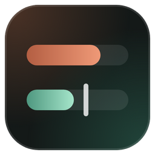
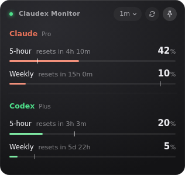

# Claudex Monitor

A small desktop widget that shows your **Claude Code** and **Codex** usage limits side by side.



- 5-hour and weekly usage for both, with reset countdowns
- The tick on each bar shows how much of the window has passed. If the bar is past the tick, you're using it up early
- Bars turn amber at 70% and red at 90%
- The light top left is green when both are up to date, amber when showing old figures, red when a source fails
- Stays on top, lives in the tray, the dropdown at the top sets how often it refreshes, and **Ctrl+Alt+M** shows or hides it

## Run it

You need Node.js 20+, Claude Code signed in, and the Codex CLI signed in.

```bash
npm install
npm start
```

Run `npm run check` to print the numbers in the terminal instead.

**Windows (WSL):** run `bash scripts/install-windows-shortcut.sh` once to put a **Claudex Monitor** icon on your desktop.

## How it works

- **Claude:** reads Claude Code's local login (`~/.claude/.credentials.json`) and asks Anthropic's usage endpoint.
- **Codex:** runs `codex app-server` and asks it for rate limits.

Neither is an official public API, so either may change. On macOS, Claude Code stores its login in the Keychain, so the Claude half doesn't work there yet.
